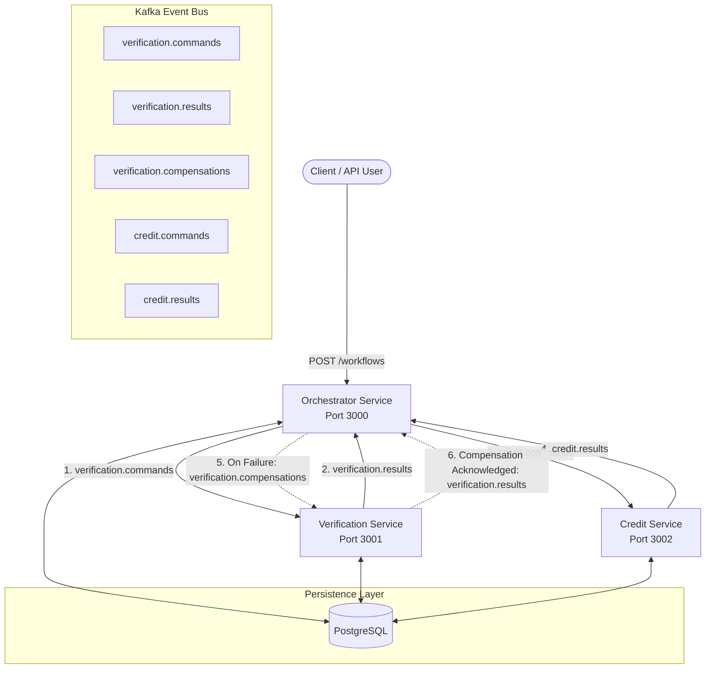
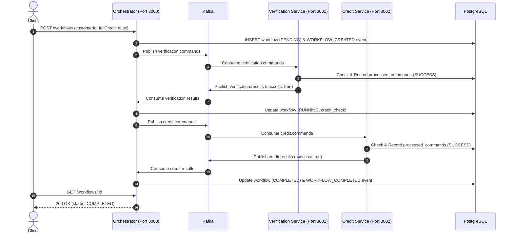
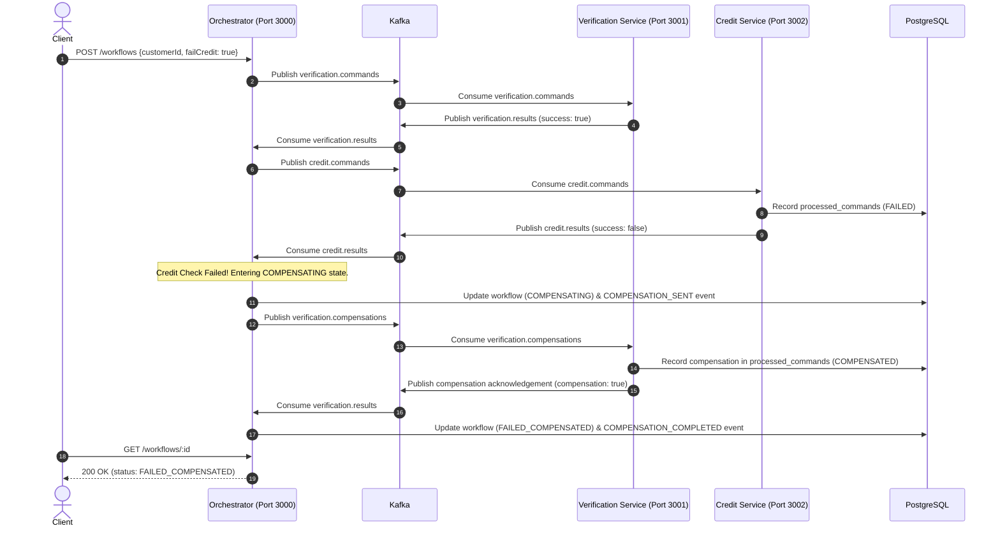

# FlowMaster — Distributed Task Orchestrator

FlowMaster is a distributed task orchestration engine built with **Node.js**, **Express**, **Apache Kafka**, **PostgreSQL**, and the **Saga Pattern** (orchestration-based). It executes multi-step business workflows with durable persistence, crash-recovery mechanisms, and database-backed persistent idempotency.

---

## 🏗️ Architecture



### Components
All three services are **Node.js Express microservices**. Crucially, **all inter-service communication is 100% event-driven via Kafka topics**. No service makes direct HTTP calls to any other service.

1. **Orchestrator Service (`services/orchestrator`, Port 3000)**:
   - Dynamic workflow engine driven by `config/workflow.yaml`.
   - Exposes REST API for initiating workflows, querying state, and replaying audit trails.
   - Manages workflow state machine transitions (`PENDING` -> `RUNNING` -> `COMPENSATING` -> `FAILED_COMPENSATED` / `COMPLETED` / `FAILED`).
   - Ensures Kafka topics exist before consumer groups connect.
   - Executes crash recovery on startup for interrupted workflows.
2. **Verification Service (`services/verification`, Port 3001)**:
   - Express application exposing `/health`.
   - Listens on `verification.commands` and `verification.compensations`.
   - Supports forward verification and rollback compensation.
   - Persistent idempotency via PostgreSQL table `processed_commands`.
3. **Credit Service (`services/credit`, Port 3002)**:
   - Express application exposing `/health`.
   - Listens on `credit.commands`.
   - Evaluates credit checks and returns decisions via `credit.results`.
   - Persistent idempotency via PostgreSQL table `processed_commands`.
4. **Apache Kafka (KRaft mode)**:
   - Event broker with partition-based routing and consumer groups.
5. **PostgreSQL**:
   - Stores workflow state (`workflows`), event logs (`workflow_events`), and worker command idempotency logs (`processed_commands`).

---

## 🔄 Saga Sequence Diagrams

### 1. Happy Path Workflow (All Steps Succeed)


### 2. Saga Compensation Path (Credit Fails -> Verification Compensated)


---

## 🚀 Getting Started

### Prerequisites
- [Docker Desktop](https://www.docker.com/products/docker-desktop/) installed and running.
- (Optional) Node.js v20+ to run automated tests from the host terminal.

### Run with Docker Compose
Open PowerShell or your terminal in the project directory:

```bash
docker compose up -d --build
```

Wait a few seconds for health checks to pass. Check container status:
```bash
docker ps
```

All 5 containers should be running and healthy:
- `flowmaster-kafka` (healthy, port 9092)
- `flowmaster-postgres` (healthy, port 5432)
- `flowmaster_deepanjali-orchestrator-1` (port 3000)
- `flowmaster_deepanjali-verification-1` (port 3001)
- `flowmaster_deepanjali-credit-1` (port 3002)

> **Development Credentials Notice**: The credentials in `docker-compose.yml` (`flowmaster_dev_password`) are strictly development-only local defaults for testing and are not intended for production environments.

---

## 📡 REST API Reference

### 1. Health Checks (All Services)
Each service exposes an independent Express health endpoint:
- Orchestrator: `GET http://localhost:3000/health`
- Verification: `GET http://localhost:3001/health`
- Credit: `GET http://localhost:3002/health`

**Orchestrator Response (200 OK):**
```json
{
  "status": "ok",
  "service": "orchestrator",
  "workflow": "loan-application",
  "steps": ["verification", "credit_check"]
}
```

### 2. Submit Workflow
```http
POST http://localhost:3000/workflows
Content-Type: application/json
Idempotency-Key: optional-unique-client-key
```
**Request Body:**
```json
{
  "customerId": "C-100",
  "failCredit": false,
  "failVerification": false
}
```
**Response (202 Accepted):**
```json
{
  "workflow": {
    "id": "3957bb4d-52b4-4d9a-bb51-704942c9a5e9",
    "status": "RUNNING",
    "current_step": "verification",
    "input": { "customerId": "C-100", "failCredit": false, "failVerification": false }
  }
}
```

### 3. Query Workflow State & Event History
```http
GET http://localhost:3000/workflows/:id
```
**Response (200 OK):**
```json
{
  "workflow": {
    "id": "3957bb4d-52b4-4d9a-bb51-704942c9a5e9",
    "status": "COMPLETED",
    "current_step": "done"
  },
  "events": [
    { "event_type": "WORKFLOW_CREATED", "payload": { ... }, "created_at": "..." },
    { "event_type": "VERIFICATION_COMMAND_SENT", "payload": { ... }, "created_at": "..." },
    { "event_type": "VERIFICATION_RESULT", "payload": { "success": true }, "created_at": "..." },
    { "event_type": "CREDIT_CHECK_COMMAND_SENT", "payload": { ... }, "created_at": "..." },
    { "event_type": "CREDIT_CHECK_RESULT", "payload": { "success": true }, "created_at": "..." },
    { "event_type": "WORKFLOW_COMPLETED", "payload": { ... }, "created_at": "..." }
  ]
}
```

### 4. Event-Log Replay & State Verification
```http
GET http://localhost:3000/workflows/:id/replay
```
Demonstrates **Event Sourcing Replay**: Reconstructs workflow state step-by-step strictly from PostgreSQL `workflow_events` and asserts whether replayed state matches current database state.

**Response (200 OK):**
```json
{
  "workflowId": "3957bb4d-52b4-4d9a-bb51-704942c9a5e9",
  "currentStateInDb": { "id": "3957bb4d-52b4-4d9a-bb51-704942c9a5e9", "status": "COMPLETED", "current_step": "done" },
  "reconstructedState": { "id": "3957bb4d-52b4-4d9a-bb51-704942c9a5e9", "status": "COMPLETED", "current_step": "done" },
  "eventsProcessed": 6,
  "replayHistory": [
    { "eventId": "120", "eventType": "WORKFLOW_CREATED", "stateTransition": "UNKNOWN -> PENDING" },
    { "eventId": "121", "eventType": "VERIFICATION_COMMAND_SENT", "stateTransition": "PENDING -> RUNNING" },
    { "eventId": "122", "eventType": "VERIFICATION_RESULT", "stateTransition": "RUNNING -> RUNNING" },
    { "eventId": "123", "eventType": "CREDIT_CHECK_COMMAND_SENT", "stateTransition": "RUNNING -> RUNNING" },
    { "eventId": "124", "eventType": "CREDIT_CHECK_RESULT", "stateTransition": "RUNNING -> COMPLETED" },
    { "eventId": "125", "eventType": "WORKFLOW_COMPLETED", "stateTransition": "COMPLETED -> COMPLETED" }
  ],
  "stateIntegrityVerified": true
}
```

---

## 📊 Measured Workflow Latency (Actual Benchmark Data)

Benchmark conducted using `node benchmark-latency.js` across consecutive round-trip executions (HTTP submit -> Kafka command -> Worker processing -> PostgreSQL state -> Kafka result -> Orchestrator completion):

| Metric | Happy Path (`COMPLETED`) | Saga Compensation (`FAILED_COMPENSATED`) |
| :--- | :--- | :--- |
| **Sample Size** | 15 runs | 10 runs |
| **Minimum Latency** | **43.08 ms** | **72.85 ms** |
| **Average Latency** | **53.24 ms** | **97.03 ms** |
| **Median (P50)** | **47.18 ms** | **79.55 ms** |
| **P90 Latency** | **67.41 ms** | **204.49 ms** |
| **P95 Latency** | **71.33 ms** | **204.49 ms** |
| **Maximum Latency** | **71.33 ms** | **204.49 ms** |

*Measured on local Docker Desktop environment with Apache Kafka 3.9.1 and PostgreSQL 16.*

---

## 🧪 Automated Testing Scripts

Run any of the following automated test runners:

### 1. PowerShell Test Suite (Windows)
```powershell
.\test-all.ps1
```
Tests:
- Health check of all configured steps
- Happy path workflow to `COMPLETED`
- Saga compensation path to `FAILED_COMPENSATED`
- Early verification failure to `FAILED`
- HTTP `Idempotency-Key` header reuse

### 2. Orchestrator Crash Recovery Test
```powershell
node test-recovery.js
```
Demonstrates:
- Seeds incomplete workflows in `RUNNING` and `COMPENSATING` status in PostgreSQL.
- Forcefully restarts the orchestrator container (`docker restart flowmaster_deepanjali-orchestrator-1`).
- Asserts that on reboot the orchestrator inspects incomplete workflows, re-publishes missing commands, logs `WORKFLOW_RECOVERED`, and drives both workflows to their terminal states.

### 3. Latency Benchmark Runner
```powershell
node benchmark-latency.js
```

---

## 🛡️ Persistent Idempotency & Crash Recovery

### Database-Backed Idempotency
Instead of in-memory `Set`/`Map` objects that reset on crash, worker services store command execution records in PostgreSQL:

```sql
CREATE TABLE IF NOT EXISTS processed_commands (
  id BIGSERIAL PRIMARY KEY,
  service_name TEXT NOT NULL,
  command_key TEXT NOT NULL,
  workflow_id TEXT NOT NULL,
  status TEXT NOT NULL,
  output JSONB,
  created_at TIMESTAMPTZ NOT NULL DEFAULT NOW(),
  UNIQUE(service_name, command_key)
);
```

- If a duplicate message arrives from Kafka (at-least-once delivery), the worker checks `(service_name, command_key)`.
- If already processed, it re-emits the cached result without repeating side effects.
- If fresh, it writes to PostgreSQL before emitting Kafka result events.

---

## 📋 Requirements & Implementation Status

### Mandatory Requirements
| Requirement | Status | Evidence / Implementation |
| :--- | :---: | :--- |
| **Three Node.js Services** | **PASS** | Orchestrator (port 3000), Verification (port 3001), Credit (port 3002). All three are Express apps. |
| **Event-Driven via Kafka** | **PASS** | `verification.commands`, `verification.results`, `credit.commands`, `credit.results`, `verification.compensations`. Zero inter-service HTTP calls. |
| **YAML Workflow Configuration** | **PASS** | Orchestrator dynamically loads `config/workflow.yaml` to derive step order, topics, and compensation routes. |
| **PostgreSQL Persistence** | **PASS** | Workflows stored in `workflows`, events in `workflow_events`, worker deduplication in `processed_commands`. |
| **Saga Compensation** | **PASS** | `failCredit: true` triggers `verification.compensations`; verification rolls back and sends ack; orchestrator records `COMPENSATION_COMPLETED` and marks `FAILED_COMPENSATED`. |
| **Early Step Failure** | **PASS** | `failVerification: true` immediately transitions workflow to `FAILED`; credit check is not invoked. |
| **Persistent Idempotency** | **PASS** | Worker services backed by PostgreSQL `processed_commands` table with `UNIQUE(service_name, command_key)`. HTTP API supports `Idempotency-Key` header. |
| **Crash Recovery on Reboot** | **PASS** | `recoverWorkflows()` scans `PENDING`, `RUNNING`, and `COMPENSATING` workflows, checks recorded events, and resumes execution without duplicate side effects. |
| **Event-Log Replay** | **PASS** | `GET /workflows/:id/replay` re-evaluates all audit events and verifies state integrity. |
| **Automated Test Coverage** | **PASS** | Tested via `test-all.ps1`, `test-suite.js`, `test-recovery.js`, and `benchmark-latency.js`. |

### Advanced / Bonus / Production Enhancements
| Feature | Status | Notes |
| :--- | :---: | :--- |
| **Transactional Outbox Pattern** | **NOT IMPLEMENTED** | Currently uses direct DB query + Kafka producer publish. In production, an Outbox table + Debezium CDC eliminates dual-write edge cases. |
| **Application Circuit Breaker** | **NOT IMPLEMENTED** | Kafka consumer backoff handled by KafkaJS; circuit breaker library (e.g. Opossum) not integrated. |
| **Dead-Letter Queue (DLQ)** | **NOT IMPLEMENTED** | Poison-pill message handling logs error; dedicated `*.dlq` topic routing not active. |
| **Distributed Tracing (Jaeger)** | **NOT IMPLEMENTED** | `eventId` and `workflowId` propagated in payloads, but OpenTelemetry/Jaeger SDK not wired. |
| **Prometheus Metrics** | **NOT IMPLEMENTED** | `/health` implemented, but Prometheus `/metrics` endpoint not configured. |
| **Redis / BullMQ** | **NOT IMPLEMENTED** | Architectural decision: Kafka is used as the distributed message bus; Redis was not introduced to avoid unnecessary architectural overhead. |
| **Database Sharding** | **NOT IMPLEMENTED** | Kafka uses 3 partitions; PostgreSQL operates as a single primary instance with indexing. |
